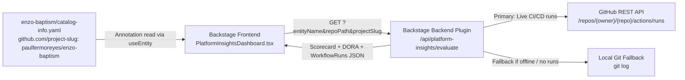

# Piece 1 — Live GitHub Actions Telemetry for Real DORA Metrics

## 1. Why This Matters (DevOps → Platform Engineering)

When you first introduce DORA metrics, relying solely on `git log` commits is an approximation:
- A commit to `main` does **not** guarantee a deployment succeeded (it might have failed in CI or stalled at an approval gate).
- Commit timestamps don't capture how long the **actual pipeline** took to build, approve, and ship.

By connecting your Backstage IDP backend directly to the **GitHub Actions REST API**, your DORA metrics reflect **true production delivery telemetry**—with an automatic fallback to local Git history if the API is unreachable.

### How Each DORA Metric Maps to GitHub Actions

| DORA Metric | Git Heuristic (Before) | Live GitHub Actions Telemetry (Now) |
| --- | --- | --- |
| **Deployment Frequency** | Commits to `main` / week | Completed **successful** `deploy.yml` runs / week |
| **Lead Time for Changes** | Time between consecutive commits | Median time from `head_commit.timestamp` → successful deploy `updated_at` |
| **Change Failure Rate** | `%` of commits prefixed `fix:` / `revert` | `%` of completed `deploy.yml` runs with `conclusion === 'failure'` |
| **Mean Time to Recovery** | Time from previous commit to `fix:` commit | Average time from a failed `deploy.yml` run to the next green `deploy.yml` run |

---

## 2. Architecture Flow



---

## 3. Step-by-Step Implementation Guide

### Step 1: Ensure the Managed App Declares `github.com/project-slug`
In `/Users/yogi/Desktop/Projects/enzo-baptism/catalog-info.yaml`, verify the `Component` metadata includes:

```yaml
metadata:
  annotations:
    github.com/project-slug: paulfermoreyes/enzo-baptism
    idp.dev/local-repo-path: /Users/yogi/Desktop/Projects/enzo-baptism
```

This annotation is the standard Backstage contract used by GitHub Actions, Dependabot, and Security plugins to discover the upstream repository without hardcoding URLs in the platform.

---

### Step 2: Fetch Live Workflow Runs in the Backend Plugin
In `/Users/yogi/Desktop/Projects/dev-idp/packages/backend/src/plugins/platformInsights.ts`:

1. Read `projectSlug` from `req.query.projectSlug`.
2. Query `GET https://api.github.com/repos/${projectSlug}/actions/runs?per_page=30`:
   - Works automatically for **public repositories** (60 req/hr).
   - If `process.env.GITHUB_TOKEN` is exported, sends `Authorization: Bearer ${GITHUB_TOKEN}` (5,000 req/hr + **private repository** access).
3. Classify deployment workflows (`deploy.yml`, `Deploy to GitHub Pages`, etc.) separately from PR CI runs (`ci.yml`) via `isDeploymentWorkflow()`.
4. Compute all 4 DORA metrics from completed deployment runs, and return `source: 'github-actions'` alongside the raw `workflowRuns[]` array.
5. If the GitHub API fails (offline/rate-limited) or has zero completed deployment runs, fall back cleanly to `git log` and return `source: 'git-fallback'`.

---

### Step 3: Surface Live Telemetry & Pipeline Runs in Backstage UI
In `/Users/yogi/Desktop/Projects/dev-idp/packages/app/src/modules/platformInsights/PlatformInsightsDashboard.tsx`:

1. Extract `github.com/project-slug` via `useEntity()`.
2. Pass `projectSlug` to `/api/platform-insights/evaluate`.
3. Display a **Telemetry Source** badge (`Live GitHub Actions` in green vs `Git Fallback` in amber).
4. Render the **Live GitHub Actions Pipeline Runs** table with:
   - Clickable workflow name linking directly to the GitHub Actions run logs
   - `Deploy` vs `CI` badge
   - Color-coded conclusion chip (`success`, `failure`, `cancelled`)
   - Commit SHA + message, execution duration, and trigger timestamp

---

### Step 4: Optional — Configure a GitHub Token (Private Repos & Higher Rate Limits)
For private repositories or heavy local testing, create a fine-grained GitHub Personal Access Token with **Actions: Read-only** permission and start Backstage with:

```bash
nvm use 24
export GITHUB_TOKEN="github_pat_..."
cd /Users/yogi/Desktop/Projects/dev-idp
yarn start
```

---

## 4. Verification Checklist

1. **Typecheck**:
   ```bash
   cd /Users/yogi/Desktop/Projects/dev-idp && yarn tsc
   ```
2. **Test Backend API Directly**:
   ```bash
   curl -s "http://localhost:7007/api/platform-insights/evaluate?entityName=enzo-baptism&repoPath=/Users/yogi/Desktop/Projects/enzo-baptism&projectSlug=paulfermoreyes/enzo-baptism" | jq '.dora | {source, totalDeployRuns, deploymentFrequency, leadTimeForChanges, changeFailureRate, meanTimeToRecovery}'
   ```
3. **Verify in Backstage UI**:
   - Open `http://localhost:3000/catalog/default/component/enzo-baptism/scorecards-dora`
   - Confirm the green **Live GitHub Actions** badge appears on the **DORA Delivery Metrics** card.
   - Confirm the **Live GitHub Actions Pipeline Runs** table lists real `Deploy to GitHub Pages` runs with clickable links to GitHub Actions.

---

## 5. Troubleshooting

| Symptom | Cause | Fix |
| --- | --- | --- |
| Shows `Git Fallback` instead of `Live GitHub Actions` | Private repo without `GITHUB_TOKEN`, API rate limit (60/hr unauthenticated), or offline | Export `GITHUB_TOKEN` and restart `yarn start` |
| `totalDeployRuns: 0` | Workflow name/path doesn't contain `deploy`, `release`, or `pages` | Update `isDeploymentWorkflow()` in `platformInsights.ts` |
| High Lead Time value | Manual approval gate (`github-pages` environment) paused between push and approval | Expected! This is a real DORA insight—approval wait time is part of Lead Time for Changes |
